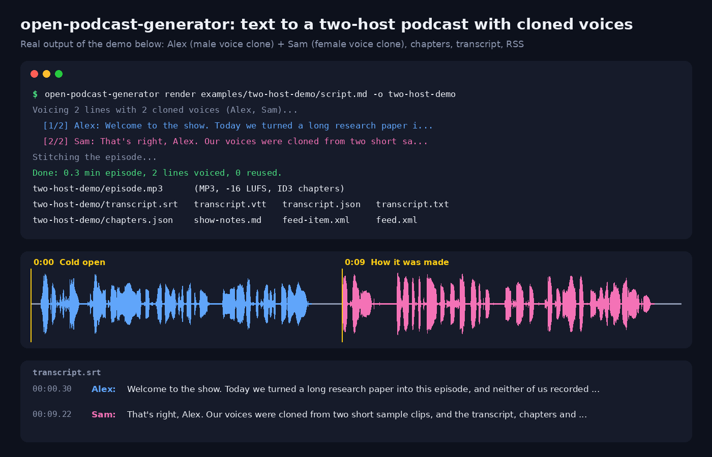
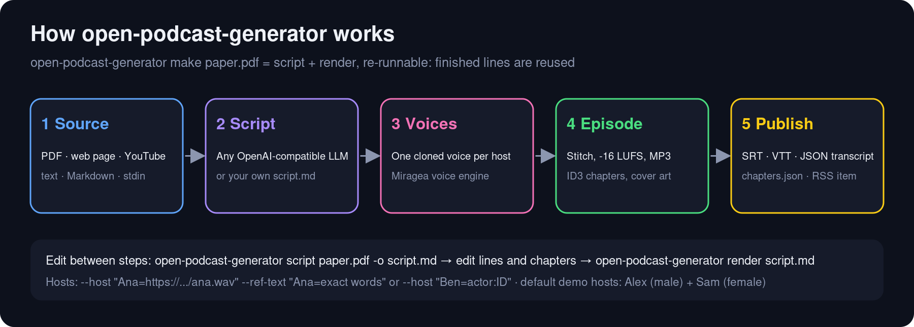

# Open Podcast Generator: open-source AI podcast generator (PDF, URL or text to a two-host podcast)

**open-podcast-generator** is an open-source AI podcast generator and command-line tool that turns a PDF, a web page, a YouTube video or plain text into a two-host podcast episode. An OpenAI-compatible LLM you choose (OpenAI, OpenRouter, Groq, DeepSeek, Ollama, LM Studio) writes the conversation, or you write it yourself. Each host speaks in their own cloned voice. You get a loudness-normalised MP3 with chapters, a timed transcript (SRT, WebVTT, JSON), show notes and an RSS feed item. It is an open-source NotebookLM podcast alternative you can script, self-host and automate.

[](https://github.com/RTY2345RR/open-podcast-generator/actions/workflows/ci.yml)
[](LICENSE)




**Web page with audio player:** [huggingface.co/spaces/miragea/open-podcast-generator](https://huggingface.co/spaces/miragea/open-podcast-generator) · **Listen to the real demo:** [episode.mp3](examples/two-host-demo/episode.mp3) (Alex, male voice clone + Sam, female voice clone, 19 s) · [transcript.srt](examples/two-host-demo/transcript.srt) · [chapters.json](examples/two-host-demo/chapters.json) · [feed.xml](examples/two-host-demo/feed.xml) · [script.md](examples/two-host-demo/script.md)

<audio controls src="https://raw.githubusercontent.com/RTY2345RR/open-podcast-generator/main/examples/two-host-demo/episode.mp3"></audio>

## Contents
- [Features](#features)
- [Quick start](#quick-start)
- [How it works](#how-it-works)
- [Use your own voices](#use-your-own-voices)
- [Write or edit the script yourself](#write-or-edit-the-script-yourself)
- [Publish: RSS feed, chapters and transcript](#publish-rss-feed-chapters-and-transcript)
- [Comparison: podcastfy, NotebookLM, Open Notebook](#comparison)
- [FAQ](#faq)
- [Troubleshooting](#troubleshooting)

## Features
- **PDF to podcast, URL to podcast, text to podcast.** Reads PDFs (pypdf), articles and web pages (main text only, no menus), YouTube captions (optional `yt-dlp`), `.txt`/`.md`/`.html`/`.srt` files, stdin or a quoted string.
- **Any LLM you configure.** Any OpenAI-compatible `/chat/completions` endpoint writes the script: OpenAI, OpenRouter, Groq, DeepSeek, Together, vLLM, or a local Ollama/LM Studio model. Five styles (`conversational`, `explainer`, `debate`, `news`, `study`) or your own, plus target length and language.
- **Two hosts, two cloned voices.** Each host gets their own voice, cloned from a 6-15 second public clip with its transcript, or a saved voice ID. Works out of the box with a male and a female demo voice. Up to 4 hosts.
- **Bring your own script.** A plain Markdown format (`## Chapter`, `Name: text`, `[pause 1]`). Write it by hand, or generate it with `script`, edit it, then `render`.
- **Podcast-ready output.** MP3 at -16 LUFS (the Apple/Spotify spoken-word target), ID3 tags, embedded **ID3 chapter markers**, optional cover art, intro and outro music.
- **Transcript and chapters.** `transcript.srt`, `transcript.vtt` (with `<v Speaker>` tags), Podcasting 2.0 `transcript.json`, `transcript.txt`, `chapters.json`, and `show-notes.md` with YouTube-style timestamps.
- **RSS feed item.** `feed-item.xml` to paste into your existing feed, and a complete `feed.xml` (iTunes and Podcasting 2.0 `podcast:transcript` / `podcast:chapters` tags).
- **Resumable and incremental.** Every line's request is saved with an idempotency key, so a re-run resumes instead of submitting duplicate jobs, and editing one line re-voices only that line.
- **One command install.** `uvx` runs it with no setup; ffmpeg ships in the `imageio-ffmpeg` wheel when it is not on your PATH.

## Quick start

```bash
# 1. Keys: the voice engine (required) and an LLM (only for auto-written scripts)
export MIRAGEA_API_KEY=...      # https://miragea.ai/workspace/api
export OPENAI_API_KEY=sk-...    # or LLM_API_KEY + LLM_BASE_URL for any OpenAI-compatible API

# 2. PDF to podcast in one command
uvx --from git+https://github.com/RTY2345RR/open-podcast-generator open-podcast-generator make paper.pdf
```

Or install it:

```bash
pip install git+https://github.com/RTY2345RR/open-podcast-generator          # add [youtube] for YouTube links
open-podcast-generator make https://en.wikipedia.org/wiki/Rayleigh_scattering --minutes 8 --style explainer
open-podcast-generator make notes.md --llm-base-url http://localhost:11434/v1 --llm-model llama3.1   # local Ollama
open-podcast-generator render examples/two-host-demo/script.md -o demo               # no LLM needed
open-podcast-generator doctor                                                         # check ffmpeg, keys, API
```

Output folder (`podcast-<title>/`):

| File | What it is |
|---|---|
| `episode.mp3` | The stitched episode, -16 LUFS, ID3 tags and chapter markers |
| `script.md` | The script that was voiced (edit and re-run `render`) |
| `transcript.srt` / `.vtt` / `.json` / `.txt` | Timed transcript with speaker names |
| `chapters.json` | Podcasting 2.0 chapters |
| `show-notes.md` | Description, hosts and chapter timestamps |
| `feed-item.xml` / `feed.xml` | RSS `<item>` and a complete one-episode feed |
| `clips/`, `state.json` | Per-line audio cache and task ids (makes re-runs resume) |

Using an AI coding agent (Claude Code, Cursor, Codex)? To give it the voice tools as a skill, tell it: `Install https://miragea.ai/skills/miragea-audio/install.md`

## How it works



1. **Source**: the text is extracted from the PDF, page, captions or file (the first 60,000 characters are used).
2. **Script**: the LLM gets the source, the host names and roles, style, language and a word budget (150 words per minute) and returns `## Chapter` / `Name: text` lines. A malformed reply gets one automatic repair round.
3. **Voices**: each line is sent to the Miragea voice-cloning engine with its host's reference clip, 4 lines in parallel. Lines over 600 characters are split at sentence boundaries.
4. **Episode**: clips are trimmed of edge silence and joined with natural gaps (short within a turn, longer between speakers, longer between chapters), then encoded once to MP3 with loudness normalisation and chapters.
5. **Publish**: the exact clip timings produce the transcript, chapters, show notes and RSS item, so captions line up with the audio.

## Use your own voices

A host is `NAME=VOICE`, where VOICE is either a public URL of a clean 6-15 second speech clip to clone, or `actor:ID` for a voice saved on your account (`open-podcast-generator voices` lists them). Pass the clip's exact words with `--ref-text` for the best clone.

```bash
open-podcast-generator make paper.pdf \
  --host "Maya=https://example.com/voices/maya.wav" --ref-text "Maya=Exact words spoken in the clip." \
  --host "Leo=actor:YOUR_ACTOR_ID"
```

Or keep hosts in a file and pass `--hosts-file hosts.json`:

```json
{"hosts": [
  {"name": "Maya", "voice": "https://example.com/voices/maya.wav", "reference_text": "Exact words spoken in the clip.", "role": "host who asks the questions"},
  {"name": "Leo", "voice": "actor:YOUR_ACTOR_ID", "role": "expert guest", "speed": 1.05}
]}
```

`role` goes into the LLM prompt. Only clone voices you have the right to use. The default hosts, **Alex** (male) and **Sam** (female), are cloned from the CMU ARCTIC speech corpus (see [CREDITS.md](CREDITS.md)).

## Write or edit the script yourself

```markdown
---
title: Why the sky is blue
description: Two hosts explain Rayleigh scattering.
show: Science in Ten
---
## Cold open
Alex: So, why is the sky blue?
Sam: Short answer: sunlight bounces off air, and blue bounces the most.
[pause 1]
## The physics
Alex: Why blue and not violet?
```

- `## Heading` starts a chapter; `Name: text` is a spoken line; an unprefixed line continues the previous one.
- `[pause 2]` adds 2 seconds of silence; lines starting with `>` are notes and are not spoken.
- Stage directions such as `(laughs)` and `*sighs*` are removed before voicing.

`open-podcast-generator script paper.pdf -o script.md` writes the LLM draft without voicing it, so you can fix facts and tone first, then `open-podcast-generator render script.md`.

## Publish: RSS feed, chapters and transcript

Pass the public URL where you will upload the folder, and the feed links resolve:

```bash
open-podcast-generator make paper.pdf --show "Paper Club" --author "Jane Doe" --episode 12 \
  --cover cover.jpg --intro jingle.mp3 --base-url https://cdn.example.com/paper-club/ep12
```

Upload the folder to any static host (S3, R2, GitHub Pages). Paste `feed-item.xml` into your existing feed, or submit `feed.xml` as a new show. Apps that support the Podcasting 2.0 tags read `chapters.json` and the transcript, and many players also read the ID3 chapter markers embedded in the MP3. `show-notes.md` timestamps also work as YouTube chapters.

## Comparison

| | **open-podcast-generator** | [podcastfy](https://github.com/souzatharsis/podcastfy) | Google NotebookLM Audio Overviews | [Open Notebook](https://github.com/lfnovo/open-notebook) |
|---|---|---|---|---|
| Type | CLI + Python package | Python package, CLI, API | Hosted app | Self-hosted research app (Docker) |
| Licence | MIT | Apache-2.0 | Proprietary | MIT |
| Inputs | PDF, URL, YouTube, text, stdin | PDF, URL, YouTube, text, **images**, **topic with web search** | Docs, URLs, YouTube, more | Docs, URLs, more |
| Script LLM | Any OpenAI-compatible endpoint, local or cloud | 100+ models via LiteLLM | Gemini only | Several providers |
| Edit the script before voicing | Yes, Markdown file | Yes, transcript file | No | Not documented |
| **Each host in their own cloned voice** | **Yes, from a short clip or a saved voice** | Voices of the chosen TTS provider (OpenAI, Google, ElevenLabs, Edge); no cloning from a clip | No, built-in voices | TTS provider voices |
| **Timed transcript (SRT/VTT/JSON)** | **Yes** | Text transcript, untimed | Not offered | Not documented |
| **Chapters (ID3 + JSON)** | **Yes** | Not documented | Not offered | Not documented |
| **RSS feed item** | **Yes** | Not documented | Not offered | Not documented |
| Loudness normalised (-16 LUFS) | Yes | Not documented | n/a | Not documented |
| Resume a stopped run without duplicate jobs | Yes | Not documented | n/a | Not documented |
| Long-form (30+ min) | Yes, by `--minutes` and line splitting | Yes, dedicated longform mode | Yes | Yes |

podcastfy is the more mature project for multimodal input (images, topic search) and LLM breadth. Choose open-podcast-generator when the voices must be your own, when you need a publishable episode (chapters, transcript, RSS) rather than an MP3 alone, or when you want an editable script step. Facts as of November 2026; corrections welcome in issues.

## FAQ

### What is the best open-source NotebookLM podcast alternative?
For a self-hosted, scriptable NotebookLM podcast alternative, use open-podcast-generator when you want your own cloned voices plus transcript, chapters and RSS, podcastfy when you need image inputs or topic research, and Open Notebook when you want the whole NotebookLM research workspace.

### How do I turn a PDF into a podcast with AI?
Run `open-podcast-generator make paper.pdf`. The text is extracted, an LLM writes a two-host conversation and each host is voiced. Scanned PDFs need OCR first (for example `ocrmypdf`).

### Is there a free AI podcast generator?
The tool is free and MIT-licensed, and script writing can run on a free local model through Ollama. Voicing uses the Miragea voice engine, which needs an account and API key.

### Can I use my own voice in an AI podcast?
Yes. Host your own 6-15 second clip at a public URL and pass `--host "Me=https://.../me.wav" --ref-text "Me=what you said in the clip"`. Each host can have a different cloned voice.

### Can I generate a podcast from a URL, article or YouTube video?
Yes. Pass any web URL; for YouTube install the extra (`pip install "open-podcast-generator[youtube] @ git+https://github.com/RTY2345RR/open-podcast-generator"`) and the video's captions are used.

### Does it work with Ollama or other local LLMs?
Yes: `--llm-base-url http://localhost:11434/v1 --llm-model llama3.1`. Any server exposing the OpenAI `/chat/completions` API works (LM Studio, vLLM, llama.cpp server). No API key is needed for localhost.

### How do I make a two-person podcast with AI?
The default is two hosts: one asks, one explains. Change their names, voices and roles with `--host` and a hosts file, and the style with `--style debate|explainer|news|study|conversational`.

### What languages are supported?
Set `--language` (for example `--language Spanish`). The LLM writes in that language, and the voice engine speaks the text it is given in the cloned voice.

### How long can an episode be?
`--minutes` sets the target; 5-20 minutes works well. Long sources are cut to the first 60,000 characters; for a book, generate one episode per chapter.

### How do I publish the AI podcast to Spotify or Apple Podcasts?
Upload the output folder to static hosting, pass `--base-url`, and submit `feed.xml` (or add `feed-item.xml` to your feed) in Spotify for Creators or Apple Podcasts Connect.

### Is there a podcast generator MCP server or Claude skill?
Use this CLI from any agent, or see the related projects below for MCP servers and Agent Skills.

## Troubleshooting

| Problem | Fix |
|---|---|
| `MIRAGEA_API_KEY is not set` | Create a key at https://miragea.ai/workspace/api and `export MIRAGEA_API_KEY=...` |
| `Writing the script needs an LLM` | Set `OPENAI_API_KEY` or `LLM_API_KEY` (+ `LLM_BASE_URL`), point `--llm-base-url` at Ollama, or write `script.md` and use `render` |
| `synthesis_failed` for a cloned voice | The engine must be able to download the clip: use a direct, public http(s) link to a WAV/MP3 (not a page, not a login-protected or Hugging Face `resolve` URL), 6-15 s of clean speech, and pass the exact `--ref-text` |
| `The script has speakers with no voice` | Every `Name:` in the script needs a `--host Name=...` (default hosts are Alex and Sam) |
| A run stopped half way | Run the same command again. Finished lines are reused and pending tasks are resumed, never resubmitted |
| `This PDF has no extractable text` | It is a scan: run `ocrmypdf in.pdf out.pdf` first |
| `ffmpeg was not found` | Install ffmpeg or set `FFMPEG_BINARY`; the bundled `imageio-ffmpeg` binary is used otherwise |
| YouTube link fails | Install the `[youtube]` extra; the video must have captions |

`open-podcast-generator doctor` checks ffmpeg, both keys and the voice API in one go.

## Configuration

| Variable | Default | Purpose |
|---|---|---|
| `MIRAGEA_API_KEY` | (required) | Voice engine key |
| `LLM_API_KEY` / `OPENAI_API_KEY` | | Script LLM key |
| `LLM_BASE_URL` / `OPENAI_BASE_URL` | `https://api.openai.com/v1` | Any OpenAI-compatible API root |
| `LLM_MODEL` | `gpt-4o-mini` | Script model |
| `MIRAGEA_BASE_URL` | `https://miragea.ai/v1` | Voice API root |
| `FFMPEG_BINARY` | PATH or bundled | ffmpeg to use |

Run `open-podcast-generator make --help` for every flag.

## Development

```bash
git clone https://github.com/RTY2345RR/open-podcast-generator && cd open-podcast-generator
pip install -e ".[dev]" && pytest   # tests mock the voice API and the LLM
```

## Related projects
- [youtube-dubbing-mcp](https://github.com/RTY2345RR/youtube-dubbing-mcp): YouTube dubbing MCP server with one cloned voice per speaker.
- [miragea-voice-mcp](https://github.com/RTY2345RR/miragea-voice-mcp) (PyPI `tts-mcp-server`): voiceover and captions MCP server for AI agents.
- [miragea-agent-skills](https://github.com/RTY2345RR/miragea-agent-skills): Agent Skills for voiceover, dubbing and captions in Claude Code and other agents.

## Credits and licence
MIT licence. Voices are rendered by the [Miragea](https://miragea.ai) voice-cloning engine. Default demo voices come from the CMU ARCTIC corpus; see [CREDITS.md](CREDITS.md). Machine-readable summary for AI assistants: [llms.txt](llms.txt).
